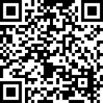

<picture>
  <source media="(prefers-color-scheme: dark)" srcset="branding/logo-dark-background.png">
  
</picture>

# S.P.R.U.C.E+

**Spam & Phishing Risk URL Checker Extension+**: a browser extension that helps you spot phishing and
scam emails in Gmail and other webmail.

> **A helper, not a guarantee.** S.P.R.U.C.E+ makes a best effort to point out warning signs, but it
> can miss dangerous emails and links, and it can flag genuine ones. It is one small layer of
> protection: keep your webmail's own spam filtering, your organization's email security, your
> browser's protections and your own judgment. When in doubt, don't click: contact the sender
> another way.

## At a glance

- **Where links really go:** short links and security-gateway wrappers are expanded, and links whose
  text shows one site but lead to another are pointed out.
- **Warning signs in your inbox, before you open anything:** fake brand names, look-alike addresses,
  known scam senders, senders using your own name, "call this number" scams.
- **A warning in the opened email,** with dangerous links marked in red.
- **QR codes and attachments** checked on your device.
- **Likely scams moved to Spam** (Gmail), with your webmail's own Report spam.
- **Tracking pixels** removed.
- **Private by design:** no account, no ads, no analytics. Every check has its own switch.

Every feature in detail, and which webmail supports what: [docs/FEATURES.md](docs/FEATURES.md).

## Install

- **Chrome and Edge:** once it is published, from the Chrome Web Store (Edge: Edge Add-ons). To install
  it yourself, download `spruce-<version>-chrome-manual-install.zip` from the
  [releases page](https://github.com/thecodewarrior2/SPRUCE-Browser-Extension/releases) and follow
  [docs/INSTALL-FOR-TESTERS.md](docs/INSTALL-FOR-TESTERS.md).
- **Firefox (desktop):** once it is published, from addons.mozilla.org; the releases page also has the
  Mozilla-signed `.xpi`. To try a test version, see the same install guide.
- **Safari:** not available as a download yet. It is built from this repository on a Mac
  (`tools/build-safari.sh`, or the **Safari build** workflow on GitHub); see the install guide.

Every browser's version is built from the same files in this repository (`node tools/build.js`).

## Documentation

| | |
|---|---|
| [Features](docs/FEATURES.md) | Everything the extension does, and which webmail supports what |
| [Admin guide](docs/ADMIN-GUIDE.md) | Deploying it to an organization; **every** policy key, including the administrator-only ones |
| [Privacy policy](PRIVACY.md) | What is read on your device, what can leave it, and to whom |
| [Architecture](docs/ARCHITECTURE.md) | How it works inside, with diagrams |
| [Development](docs/DEVELOPMENT.md) | Building, testing and publishing; repository layout |
| [Manual install](docs/INSTALL-FOR-TESTERS.md) | Installing a release download or test version yourself |
| [Store listing](store/STORE-LISTING.md) | Chrome Web Store listing text, permission reasons and images |
| [Changelog](CHANGELOG.md) | Every version, what changed and why |

The extension's own **Help** tab (Settings → Help) explains every warning, the privacy details and
troubleshooting.

## Support the project

S.P.R.U.C.E+ is free, with no ads and no tracking. If you find it useful, you can support its
development with a donation:
[**Donate with PayPal**](https://www.paypal.com/donate/?hosted_button_id=NA8SK5RBLWGW6), or scan the code below.

## License

[Apache License 2.0](LICENSE). Bundled third-party components keep their own licenses
(`lib/PDFJS-LICENSE`, credits in the extension's Help → About).
