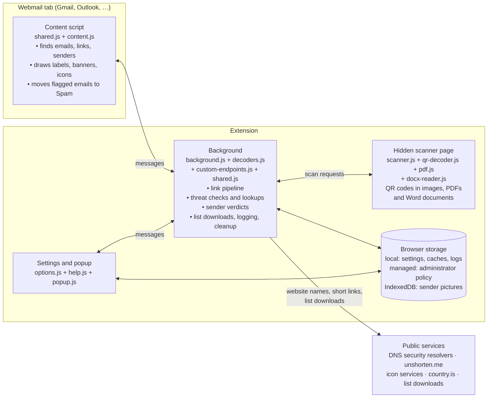
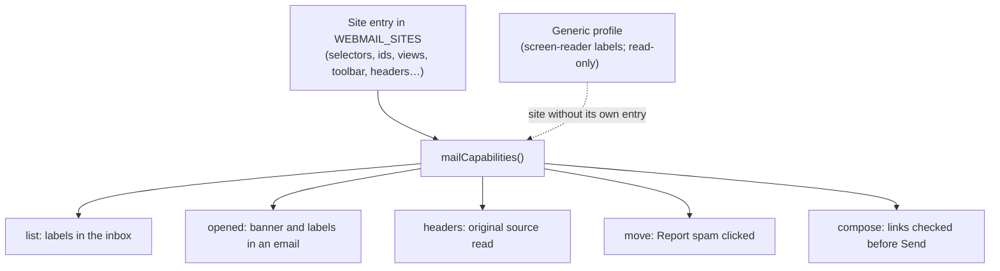
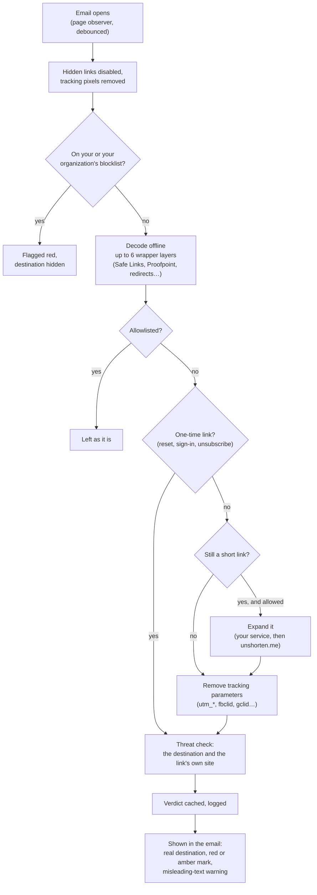
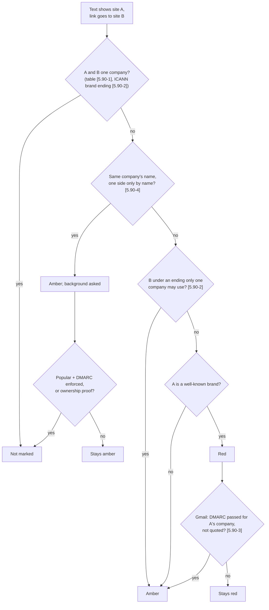
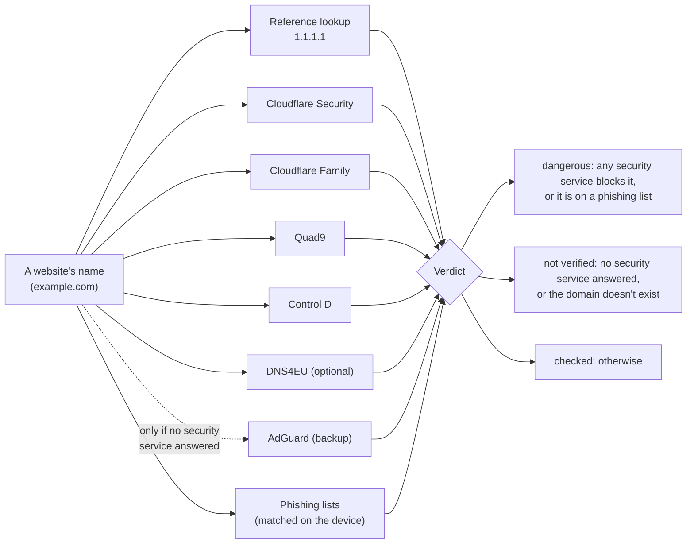
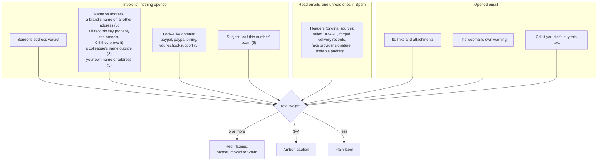
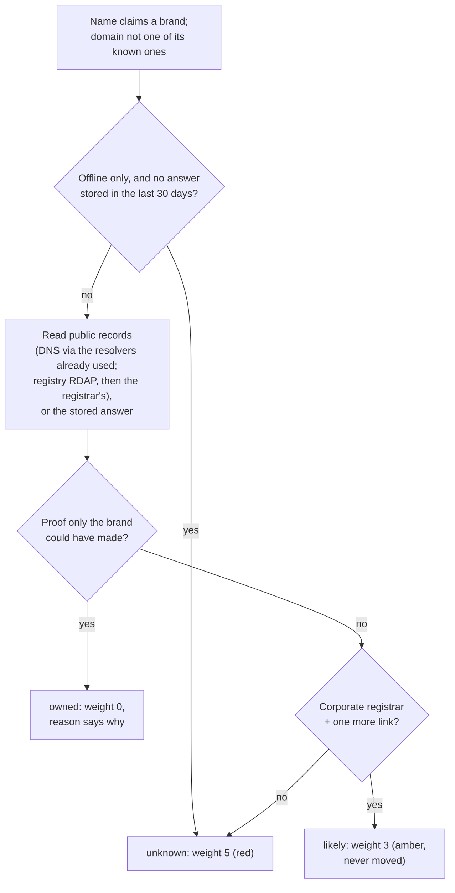
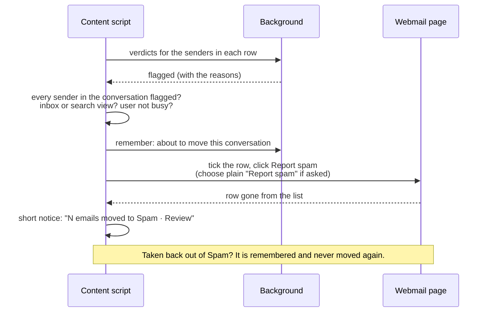
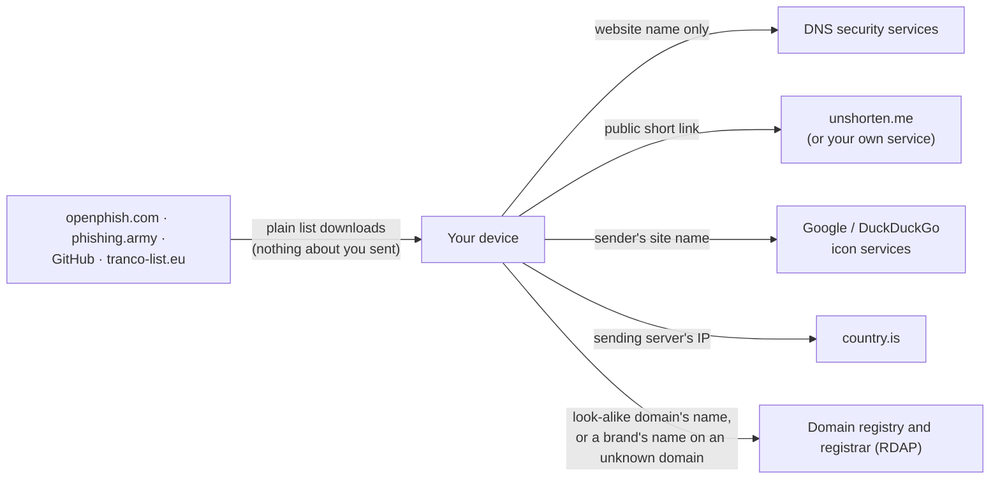

# S.P.R.U.C.E+ architecture

How the extension is put together: what runs where, how a link and a sender are judged, how an email
ends up in Spam, and what may leave the device. The diagrams are drawn by GitHub from the text in this
file. The extension's own **Help → Architecture** tab has the same material with live values from
your installation: the decoder table, the settings in force, and every network request with whether
it is switched on right now.

> **A helper, not a guarantee.** S.P.R.U.C.E+ makes a best effort to point out warning signs, but it
> can miss dangerous emails and links, and it can flag genuine ones. It is one small layer of
> protection: keep your webmail's own spam filtering, your organization's email security, your
> browser's protections and your own judgment. When in doubt, don't click: contact the sender
> another way.

## Contents

1. [The pieces](#1-the-pieces)
2. [Design rules](#2-design-rules)
3. [One engine, many webmail sites](#3-one-engine-many-webmail-sites)
4. [Checking a link](#4-checking-a-link)
5. [Is a website dangerous? The threat-check engine](#5-is-a-website-dangerous-the-threat-check-engine)
6. [Judging a sender and an email](#6-judging-a-sender-and-an-email)
7. [Moving an email to Spam](#7-moving-an-email-to-spam)
8. [QR codes and attachments](#8-qr-codes-and-attachments)
9. [What leaves the device](#9-what-leaves-the-device)
10. [Storage](#10-storage)
11. [Settings and administrator policy](#11-settings-and-administrator-policy)
12. [The three builds](#12-the-three-builds)
13. [Testing](#13-testing)
14. [Source files](#14-source-files)

## 1. The pieces

- **The content script** runs only in the supported webmail pages. It reads what the page shows, never
  sends email content anywhere, and asks the background for every verdict.
- **The background** (a service worker in Chrome, a background page in Firefox and Safari) does all
  network work and keeps the caches, so one website is looked up once however many emails link to it.
- **The hidden scanner page** exists only while an image or attachment is being read, then closes.
- **Settings and the popup** are extension pages; the popup shows the current tab's counts.

## 2. Design rules

- **Local first.** Everything that can be worked out on the device is: over 50 link-wrapper formats
  are decoded offline before any request is considered.
- **A link's own server is never contacted.** Short links are expanded by a lookup service; threat
  checks send only a website's name to DNS resolvers.
- **Best effort, and unknown is never "safe".** The checks can miss things and can be wrong; the
  extension says what it found, never that an email is safe. Anything that can't be checked is "not verified". Unreadable replies
  count as no answer.
- **One-time links are protected.** Password-reset, sign-in, verification and unsubscribe links are
  never sent, cached or logged in full.
- **Untrusted input stays untrusted.** Email content, downloaded lists, backup files and replies from
  services are validated, size-limited and parsed defensively.
- **No build step, no remote code.** Every line that runs is in the package as written. The one
  third-party library is pdf.js, unmodified, for PDF attachments.
- **Quiet by default.** Nothing runs on a timer except the daily list update and cleanup.

## 3. One engine, many webmail sites

There is one engine for every webmail. Everything that differs between sites is **data** in that
site's entry of `WEBMAIL_SITES` (shared.js): where an email's body is, how its inbox rows, sender and
subject are found, where the Report spam button is, where the original source can be read. What a site
can do follows from what its entry describes, through one function, `mailCapabilities`, which the
content script and the compatibility chart both use.

Gmail has a full entry. The other sites (Outlook on the web, Yahoo, AOL, Zoho, iCloud, Fastmail, GMX,
Proton) use the **generic profile**, which finds rows and senders through the accessibility labels
well-built webmail provides. It only reads: it never clicks, so moving to Spam waits for a site's own,
tested entry.

## 4. Checking a link

When an email opens, the content script collects its links and asks the background about each
distinct address once.

Misleading-link checks run against what the link shows: text naming a different site than the
destination, a raw IP address, a `user:password@` trick, international look-alike letters (punycode),
pages hosted in public cloud storage.

### Text and destination of the same company (company matching)

Text showing one site and a link to another is fine when both belong to one company. Since 5.90 these
steps decide that, each with its own switch in `COMPANY_MATCHING` (`shared.js`); every line of code a step
touches carries its tag:

| Step | What it does | Switch it off (set to `false`, rebuild) and |
|---|---|---|
| `[5.90-1]` `oneTable` | One table of company domains for links and senders: the link check also knows every domain the sender check lists for a brand (`companyIndex`) | text bankofamerica.com, link bofa.com is red again |
| `[5.90-2]` `ownEndings` | An ending only one company may use (ICANN "brand" endings, Specification 13), from ICANN's list of endings (`gtlds.json`, downloaded monthly by `syncCompanyEndings`; until then `company-endings.json`, made by `tools/refresh-snapshot.js`). An address under one is the company's when the other side is a domain known to be a company's whose name is one of that registry's endings (`sameCompanyByEnding`: americanexpress.com and go.amex); a link to such an ending that can't be tied is amber at most | text americanexpress.com, link go.amex is red again |
| `[5.90-3]` `verifiedSender` | A red "text shows a brand's site" link is looked at again once Gmail's DMARC result is read (`reviewLinkProblem` → `verifiedSenderLinkProblem`): passed for that same company, not in a quoted part → amber. An opened email's queued move to Spam is withdrawn when its verdict no longer moves it (`withdrawOpenedMove`) | such links stay red |
| `[5.90-5]` `storedOffline` | At Offline only (lookups off), the ownership answers and DMARC policies stored from earlier lookups, and the popular-site list already downloaded, still count; nothing new is asked (`brandOwnership`, `companyDomainEvidence`, `dmarcPolicy(…, storedOnly)`) | Offline only ignores what's stored, as before |
| `[5.90-4]` `nameNeedsProof` | A domain that only carries the name of a company that uses its name under many endings (Google, Amazon, PayPal: `labels` in `BRAND_FAMILIES`) is not the company's by its name (`companyNameOf`): the link is amber and the background is asked (`companyDomainEvidence`): on the popular-site lists and enforcing DMARC, or `brandOwnership` proof → not marked. A sender named for the company at such a domain is amber, never red or moved | the name alone makes it the company's, as before 5.90 (paypal.*anything* trusted) |

With all of them off, every answer is 5.89's (a unit test checks it).

### 5.95's changes

5.95's changes have their switches in `CHANGES_5_95` (`shared.js`), in the same way:

| Change | What it does | Switch it off (set to `false`, rebuild) and |
|---|---|---|
| `[5.95-1]` `privateSuffixes` | Shared hosting platforms (github.io, pages.dev, web.app, blogspot.com…) from the private section of the Public Suffix List (downloaded monthly by `syncSharedHosting`; until then `shared-hosting.json`, made by `tools/refresh-snapshot.js`; loaded before any check, `getConfig`). A site on one is its own registrable domain (`registrableDomain`; `icannRegistrableDomain` is the platform, used by the popular-site lists). Text showing the platform itself is consistent with any site on it; a company's name chosen there is not its name under another ending (`companyNameOf`); a platform that is a company's own domain in the table (withgoogle.com) stays the company's (`companyOfDomain`); a downloaded list never blocks a platform's own ending | every site on a platform is the platform, as in 5.94 (mybank.github.io → attacker.github.io not marked) |
| `[5.95-2]` `wordAttachments` | Word attachments (.docx, .docm) go to the scanner (`attachmentKind` → `scanDocx`), which unpacks them on the device (`docx-reader.js`: only the hyperlink lists, the text parts' HYPERLINK fields and up to 20 pictures, each part size-limited): their links and the QR codes in their pictures are shown and checked like a PDF's | Word attachments aren't read |
| `[5.95-3]` (no switch) | List downloads give up waiting for an answer after 25 seconds (`LIST_ANSWER_TIMEOUT_MS`), before Chrome stops a service worker whose request takes 30 | — |
| `[5.95-4]` `arcKnownForwarders` | A failed DMARC check is only a strong sign (not a flag on its own) for a real mailing list, or for a forwarding chain (ARC) that Gmail checked and that Google or the reader's own organization sealed (`arcFromKnownForwarder`, the sealer from the `ARC-Seal` of the instance Gmail names); anyone can add a seal that checks out | any intact chain softens it, as in 5.94 |

### 5.96's changes

5.96's changes have their switches in `CHANGES_5_96` (`shared.js`), in the same way:

| Change | What it does | Switch it off (set to `false`, rebuild) and |
|---|---|---|
| `[5.96-1]` `toLineByPerson` | The "To" line is read person by person (`addressList`: split at the commas outside quotes and `<…>`), so a calendar invitation's `guest@x.org, Organizer <organizer@y.org>` is two people; the address a name shows is read as written (single quotes, a name around it, "mailto:", +tag, encoded); another address of the same domain or name is a weak sign (1), another domain a sign (2) naming both | the whole line is one person, as in 5.95 (the invitation counts 2) |
| `[5.96-2]` `colleagueLines` | Colleagues' names (`colleagueNameHash`) in Reply-To, Cc and To on outside addresses (`colleagueLineSigns`): an outside reply address 3; copied in 1, or 3 at an address imitating the organization's domain (`ownDomainLookalike`). `messageInfo` keeps each name's hash and domain with the header signs (`addressLinePeople`, `HEADER_SIGNS_VERSION` 7); the inbox list and the opened email judge them against the colleagues' names (setting **Catch look-alike senders**) | those lines aren't looked at, as in 5.95 |

## 5. Is a website dangerous? The threat-check engine

Filtering resolvers say "blocked" by answering with a sinkhole address; Quad9 answers "no such domain",
told apart from a genuinely missing domain by the reference lookup. All lookups for one site run at the
same time; conclusive answers are remembered for a while, "not verified" never is.

## 6. Judging a sender and an email

Every sender gets a verdict from its **address** (scam-sender list, phishing lists, the threat check of
its domain, a malformed address). Each **email** then adds signs found in it, each with a weight. The
weights add up: **5 or more is red** (flagged, and moved to Spam), **3 or 4 is amber** (caution).

Some senders are never judged as a whole: trusted senders (yours or your organization's), your own
organization's domain, and big providers' domains such as gmail.com, where only an exact address on a
list counts. Names of colleagues are kept only as one-way codes (hashes).

### Is a domain the brand's? (brand ownership)

Companies send from more domains than their main one, so before a brand's name on a domain not known as
the brand's counts (weight 5), the background reads public records about that domain once, online only
(`brandOwnership`; the answer is remembered 30 days per domain and brand, an unknown one a day). It also
runs before a look-alike *pattern* (a brand's name plus "billing") counts, so a brand's own second domain
isn't an imitation of it.

| Evidence | Counts as | Why a forger can't fake it |
|---|---|---|
| The brand's DMARC record sends its reports to the domain (facebook.com → facebookmail.com) | proof | needs the brand's DNS |
| The domain sends reports to the brand **and** the brand publishes `<domain>._report._dmarc.<brand>` (RFC 7489); a wildcard that answers for any name doesn't count | proof | needs the brand's DNS |
| Name servers under the brand's domain (a.ns.facebook.com), or the identical set of the brand's own servers (outside shared operators like UltraDNS or Azure DNS, and outside provider pools) | proof | needs the brand's DNS operator account |
| A corporate brand-protection registrar (MarkMonitor, CSC, Com Laude…) **and** a registrant naming the brand | proof | such registrars serve only vetted large companies |
| The domain's reports go to the brand (no authorization) | hint | anyone can point reports anywhere |
| The same provider-assigned name servers as the brand's (`dns1.p07.nsone.net`, `kate.ns.cloudflare.com`) | hint | providers assign these from a small shared pool, so unrelated customers — an imitator included — can draw the brand's pair (changed from proof in 5.87) |
| A registrant naming the brand, alone | hint | anyone can type a company's name |
| A corporate registrar, alone; a year or more of age | hint | — |

A corporate registrar plus one more hint is **likely**; anything less is **unknown**. A registrant
counts only if it names the brand unambiguously (Apple, Chase, Meta are ordinary words, so "Apple Valley
Farms" never counts). Registry records for .com and many endings name only the registrar; the
registrant comes from the registrar's own RDAP record, linked from the registry's. Only the domain name
leaves the device; the sender's own servers are never contacted.

## 7. Moving an email to Spam

Safeguards: only from the inbox and search results (never Spam, Trash, Sent or a search in them); never
while you type or have emails ticked; never a conversation you wrote in; never phishing-training emails
your organization marked. In the Spam folder, emails the same checks would move are marked red, so you
can tell those from what Gmail or you put there.

Timing: moving waits 10 seconds after the user's last click or key (so it never replaces the Undo of
something they just did) and 2 seconds after the mouse last moved over the list (so rows never shift
under a pointer in motion). While an email waits, its row is struck through and carries a banner —
"Moving to Spam…", with why it's waiting, **Move now** (the user's own request, so nothing waits) and
**Keep it** (remembered like an email taken out of Spam, never moved) — and real clicks on the row are
swallowed, so it can't be opened or selected by accident; the extension's own synthetic clicks aren't
trusted events and pass. Only pointer events are guarded: Gmail's keyboard shortcuts (j/k, Enter) can
still open the row — the opened email keeps its warnings, and the move still happens, from the opened
conversation or once the list is shown again. A move parked by the page (another view, an open conversation, a selection, a
hidden tab) is re-checked every 3 seconds, and the moment the view or tab changes back; only a pass
whose Report spam click Gmail ignored backs off, and repeated failures pause it (15 s doubling to
10 min). The toolbar popup counts the emails waiting and why.

Accounts: every message from a webmail page carries the mailbox it came from (the signed-in address
from Gmail's page title, else the site name and Gmail's /mail/u/N/ number), and every log entry
written for it — application log, History, the popup's activity, Moved to Spam, and "Seen in" on
Senders — records it. Taking a moved email out of Spam marks that move's own line in Moved to Spam
(`rescuedTs`) in the same account instead of adding a line.

## 8. QR codes and attachments

Images in an email and attachments up to 10 MB are read **on the device**. The hidden scanner page
decodes QR codes (its own reader, qr-decoder.js) in images, in PDF pages (pdf.js) and in the pictures of
Word documents (docx-reader.js unpacks them, with a size limit on every part), and every QR destination,
and every link in a PDF or Word document, goes through the same link check as a clickable link. Attachments are also checked for
scripts in SVG and HTML files, fake sign-in pages, encrypted archives and disguised file names.

## 9. What leaves the device

Only what a feature needs, and each can be switched off; **Offline only** sends nothing at all.

Email text, subjects, attachments, recipients and your address never leave the device. The complete
list, with who receives what, is in [PRIVACY.md](../PRIVACY.md).

### Downloaded lists

Seven public lists, downloaded as plain files (nothing about you is sent) and matched on the device.
Each is tracked on its own, so one failing to update never removes another's entries. Their state on
your computer is in Settings → Help → Architecture deep dive → Downloaded lists.

| List | Used for | Downloaded | License or terms |
|---|---|---|---|
| [PeterDaveHello/url-shorteners](https://github.com/PeterDaveHello/url-shorteners) | which sites are link shorteners | daily | see the project |
| [boutetnico/url-shorteners](https://github.com/boutetnico/url-shorteners) | which sites are link shorteners | daily | see the project |
| [OpenPhish community feed](https://openphish.com) | known phishing links | daily | OpenPhish Terms of Use |
| [Phishing Army](https://phishing.army) (extended) | known phishing sites | daily | CC BY-NC 4.0 |
| [Sefinek Blacklisted-Emails](https://github.com/sefinek/Blacklisted-Emails) | known scam sender addresses (Gmail) | daily | MIT |
| [Chrome UX Report top list](https://github.com/zakird/crux-top-lists) (copy by Zakir Durumeric) | popular sites protected from look-alike senders (top 10,000) | monthly | data by Google, CC BY 4.0 |
| [Tranco](https://tranco-list.eu) | popular sites protected from look-alike senders (top 10,000) | monthly | free research list (KU Leuven and others) |

Every list is treated as untrusted, and how strictly depends on what a wrong entry could do:

| Safeguard | Short-link lists | Phishing and scam lists | Popular-site lists |
|---|---|---|---|
| What a wrong entry could do | links on that site sent to unshorten.me (a privacy risk): the strictest | a false warning (never on a major site); for scam senders, that one address's email moved to Spam | that site not flagged as a look-alike (never makes a sender trusted) |
| Size limits, entry format | 2 MB, 50,000 domains; plain domains only | 40 MB, 1,500,000 entries; links, domains or full addresses | top 10,000 of each; domain names |
| Never accepted | 42 major sites and their subdomains | the same; shared cloud-storage hosting; addresses on major brands' own domains | sites that don't enforce DMARC |
| A broken download | previous copy kept | previous copy kept (also under 20 entries) | previous copy kept (also under 3,000 sites) |
| New entries held back | until seen on 3 separate days | no: phishing sites are often gone within hours | no: downloaded monthly, rankings change slowly |
| Mass-change guard | over 25% changed (minimum 250): held back | no: these lists change almost completely every day | no: each list kept on its own |

The live version, with the current numbers, is in Settings → Help → Architecture deep dive.

## 10. Storage

| Where | What | How long |
|---|---|---|
| `storage.local` | settings; recent link and sender verdicts; history of checked links; application log; moved-to-Spam memory; downloaded lists; colleague-name hashes; for read emails, the header signs and the name hashes and domains of Reply-To, Cc and To | history and log: 30 days by default (adjustable); caches: hours to weeks |
| `storage.managed` | administrator policy (read only) | set by the organization |
| IndexedDB | sender icons, colleagues' photos, company logos | refreshed weekly or monthly |

Writes for a whole email are combined into one storage write. One-time links are never stored in full.

## 11. Settings and administrator policy

Every feature has its own setting, on by default, with a matching policy key (`managed…`) that locks
it. Policy comes from Google Workspace, Microsoft Intune or Group Policy (Chrome and Edge), or
`policies.json` and Windows policy (Firefox). Some policies exist for administrators only: the
phishing-training rules, a simpler popup, and hiding the Donate button. The full list is in
[schema.json](../schema.json) and the [admin guide](ADMIN-GUIDE.md).

## 12. The three builds

All three are built from the same files by `tools/build.js`. The top-level `manifest.json` is the Chrome
one, so the repository itself loads in Chrome as it is; the Firefox and Safari manifests are made from it
by the build, so a permission or a site added for one browser is added for all of them.

| | Chrome and Edge | Firefox | Safari |
|---|---|---|---|
| Background | `background.js` as a service worker | `background.html` (event page) | `background.html` (non-persistent page) |
| QR scanner | offscreen document (`scanner.html`) | `scanner.js` in the background page | `scanner.js` in the background page |
| Policy | managed storage (`schema.json`) | `policies.json` → `3rdparty` | none |
| Managing other extensions | yes (asked first) | only when installed by policy | no |
| Package | `node tools/build.js chrome` | `node tools/build.js firefox` | `tools/build-safari.sh` (Xcode app, on a Mac) |

The code tells the browsers apart in two ways. At run time, `BROWSER` (in `shared.js`, from the extension's
own address: `chrome-extension://`, `moz-extension://` or `safari-web-extension://`) picks the few code
paths that differ — whether `background.js` loads the shared files itself (`importScripts`, Chrome) or
`background.html` loads them, and whether the QR scanner is an offscreen document or runs in the background
page. In the extension's own pages, passages written for one browser are marked `data-only="chrome"`
(or `firefox`, `safari`, several at once); `shared.js` removes the other browsers' versions before the
page's scripts run, and `theme.css` keeps marked passages hidden until then. Settings → Help therefore shows
each browser its own deployment steps.

## 13. Testing

- **Unit tests** (`tests/unit`): the decoders, the scoring rules, the header checks against sanitized
  real scam samples (`tests/fixtures`, placeholders only), the policy schema.
- **End-to-end tests** (`tests/e2e`): the real extension in Chromium on simulated Gmail, Outlook and
  Yahoo pages: labels, banners, moves to Spam, policies, the Spam folder, search results, settings.
- `node tests/run-all.js` runs everything in parallel (about 300 checks, three minutes).

## 14. Source files

| File | Role |
|---|---|
| `shared.js` | settings and policy, webmail entries, scoring rules, header checks (shared by every part) |
| `content.js` | the engine in the webmail page: links, senders, labels, banners, moving to Spam |
| `background.js` | link pipeline, threat checks, lookups, sender verdicts, lists, logging, cleanup |
| `decoders.js` | offline decoders for link wrappers and redirects |
| `custom-endpoints.js` | your organization's own threat-check and short-link services |
| `scanner.js`, `qr-decoder.js`, `lib/pdf*.mjs`, `docx-reader.js` | QR codes in images, PDFs and Word documents; the links in PDFs and Word documents |
| `icon-store.js` | sender pictures in IndexedDB |
| `options.js`, `help.js`, `popup.js` | Settings, Help (including live architecture tables), popup |
